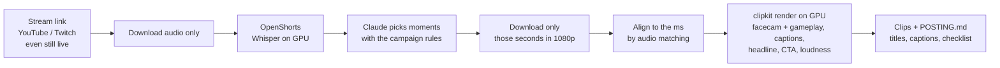

# stream-clipper-kit

**Turn 18-hour livestreams into ready-to-post Shorts and Reels.** Paste a stream link: it
transcribes the stream on your GPU, Claude reads the whole thing and picks the best moments,
and it renders vertical clips with the facecam on top, gameplay below, word-by-word captions,
a big headline box and a call to action. Built for GTA 6 streams and paid clipping campaigns,
and it works for any stream.

> **Built on [OpenShorts](https://github.com/mutonby/openshorts) by mutonby (MIT).**
> OpenShorts does the transcription, moment picking and captions. This kit adds long and live
> streams, campaign rules, gameplay layouts and a finishing renderer on top. See
> [What this adds](#what-this-adds-to-openshorts).

## Use your Claude Pro subscription: no API key needed

If you already pay for **Claude Pro or Max**, you don't need to buy an Anthropic API key. The
moment picker runs the official **Claude Code** CLI headless (`claude -p`) inside the
container, logged in with your own token, so it uses your plan instead of API billing. It's
all set up in the patch:

```bash
claude setup-token                 # sign in, copy the printed token
# openshorts/.env
LLM_PROVIDER=claude-code
CLAUDE_CODE_OAUTH_TOKEN=<paste it here>
LLM_MODEL=claude-haiku-5-5         # lightest on your limits; claude-sonnet-5-5 judges better
```

A one-hour stream is about 6-8 small Claude calls (transcript text only, no video). They
count toward the same usage limits as your chats and Claude Code; if you hit a limit the job
stops and you run it again after the reset.

Prefer pay-as-you-go? Set `LLM_PROVIDER=anthropic` and `ANTHROPIC_API_KEY` (Claude Haiku 5.5
costs about $0.01 per hour of footage). OpenShorts' own Gemini mode works too.

*The subscription option is meant for running the kit yourself with your own account, under
[Anthropic's terms](https://www.anthropic.com/legal/consumer-terms). If you turn this into a
service for other people, use an API key.*

## How it works



## What this adds to OpenShorts

OpenShorts takes one video and turns it into captioned vertical clips. This kit adds:

| Feature | What it does |
|---|---|
| **Long streams** | 18-20 hour streams without downloading them: audio first, then only the chosen seconds, lined up to the millisecond by audio matching. |
| **Still-live YouTube streams** | Clip a stream while it is still going (it fetches the recording piece by piece). |
| **20-hour Twitch VODs** | Direct playlist download in parallel (yt-dlp's seek hangs on these). |
| **Live watcher** | `live_clip.py` waits for a channel to go live and makes a batch of clips every hour. |
| **Scan mode** | List the best moments of a whole stream, part by part, without rendering. Then render only the best. |
| **Campaign rules** | One JSON file per campaign: the brief goes into Claude's picking prompt, words every clip must say are enforced, plus length limits, required CTA and hashtags. |
| **Ready-to-post notes** | `POSTING.md` per batch: titles, descriptions, Instagram captions and the campaign's checklist. |
| **Claude as the picker** | Through your Claude Pro/Max subscription (Claude Code) or the Anthropic API. |
| **Facecam-over-gameplay layout** | Per-streamer stack layout; the gameplay crop moves automatically so it never shows the facecam twice. |
| **Headline box** | Big white box with bold black text, the style of the top clip pages, with balanced line breaks. |
| **Better captions** | Word-by-word, swear words starred, name fixes (`"clicks"` -> `"Clix"`) for every clip. |
| **Sponsor overlay + end-card CTA** | For campaigns that require a logo or a "watch them live" line. |
| **Hand-picked cuts** | `--pick A-B+C-D` joins the setup and the payoff of a moment into one clip. |
| **Loudness** | Every clip levelled to -14 LUFS (what Shorts and Reels play at) with a peak limiter. |
| **GPU everywhere** | Whisper on CUDA, NVENC encoding. Developed on a laptop RTX 3050 (6 GB). |

## Quick start

Needs: Linux, an NVIDIA GPU with the
[NVIDIA Container Toolkit](setup/install_nvidia_container_toolkit.sh), Docker with Compose,
Python 3, ffmpeg, git. Claude Code installed on the host if you use the subscription option.

```bash
git clone https://github.com/sudipta57/stream-clipper-kit.git && cd stream-clipper-kit
./install.sh                         # clones OpenShorts, applies the patch, creates openshorts/.env
nano openshorts/.env                 # pick the Claude option (see above)
cd openshorts && docker compose up -d --build backend && cd ..
```

Clip the best moments of a stream:

```bash
# 1. scan: list the best moments of a 2-hour window (nothing rendered yet)
python3 kit/campaign_clip.py campaigns/example_streamer_gta6.json \
  --url "https://www.youtube.com/watch?v=VIDEO_ID" --from 0:00:00 --to 2:00:00 \
  --layout layouts/example_stack_cam_right.json --work footage/my_stream/a --scan

# 2. render the moment you like (same window; job id from the scan)
python3 kit/campaign_clip.py campaigns/example_streamer_gta6.json \
  --url "https://www.youtube.com/watch?v=VIDEO_ID" --from 0:00:00 --to 2:00:00 \
  --work footage/my_stream/a --job JOB_ID --pick 1:12:03.5-1:12:24 \
  --layout layouts/example_stack_cam_right.json --out clips/my_stream
```

Or let it pick and render everything in one go (drop `--scan`, `--job` and `--pick`).

More: [docs/USAGE.md](docs/USAGE.md) (all options, layouts, live mode) and
[docs/SETUP.md](docs/SETUP.md) (what the OpenShorts patch changes, settings, GPU).

## Repository layout

```
kit/                 campaign_clip.py (pipeline), clipkit.py (renderer), live_clip.py, repost_md.py
patches/openshorts/  the OpenShorts patch + campaign_brief.py + GPU docker-compose override
campaigns/           example campaign files (brief, rules, CTA, hashtags)
layouts/             example layouts (blur, facecam left/right/top-left)
docs/                usage and setup guides
setup/               NVIDIA Container Toolkit installer
install.sh           clones OpenShorts at the tested commit and applies the patch
```

`openshorts/`, `footage/`, `clips/`, `secrets/` and `brand/` are created locally and ignored
by git.

## Use it responsibly

- Clip only footage you have permission to use, for example streams whose creators run
  clipping campaigns, and follow each campaign's rules (allowed streams, audience, captions).
- Follow the rules of YouTube, Twitch, Instagram and TikTok. Credit the streamer in every post.
- Cookies for age-restricted videos (`--cookies`) are passed only to yt-dlp. Keep that file
  private and use a spare account.
- It never posts for you: you review every clip and post it yourself.

## Credits and license

- [OpenShorts](https://github.com/mutonby/openshorts) by mutonby, MIT License. The patch in
  `patches/openshorts/` changes OpenShorts files and keeps their MIT license (see `NOTICE`).
  OpenShorts' `cloud/` folder has a separate commercial license and is not part of this kit.
- Transcription: [faster-whisper](https://github.com/SYSTRAN/faster-whisper) (inside OpenShorts).
  Downloads: [yt-dlp](https://github.com/yt-dlp/yt-dlp). Video: [FFmpeg](https://ffmpeg.org).
- Moment picking: [Claude](https://www.anthropic.com/claude) by Anthropic.
- This kit: MIT License, see [LICENSE](LICENSE).
